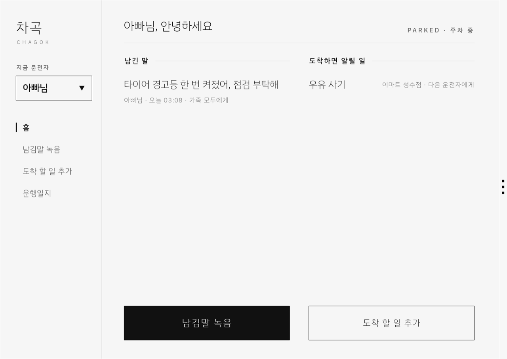
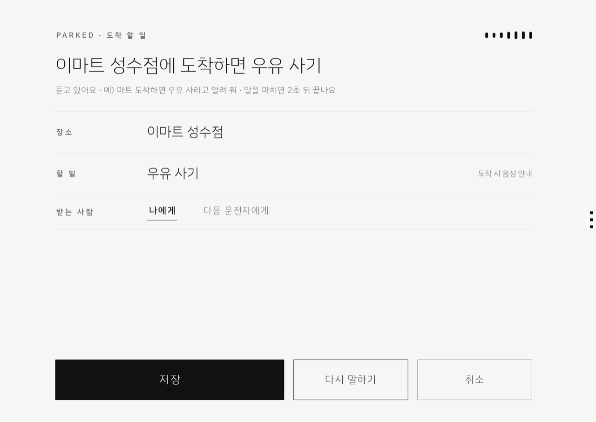
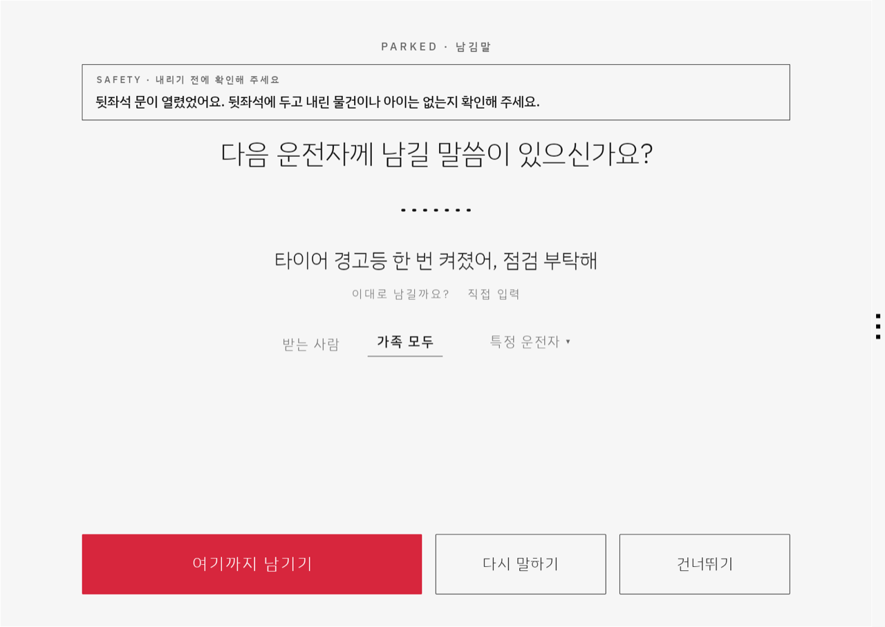
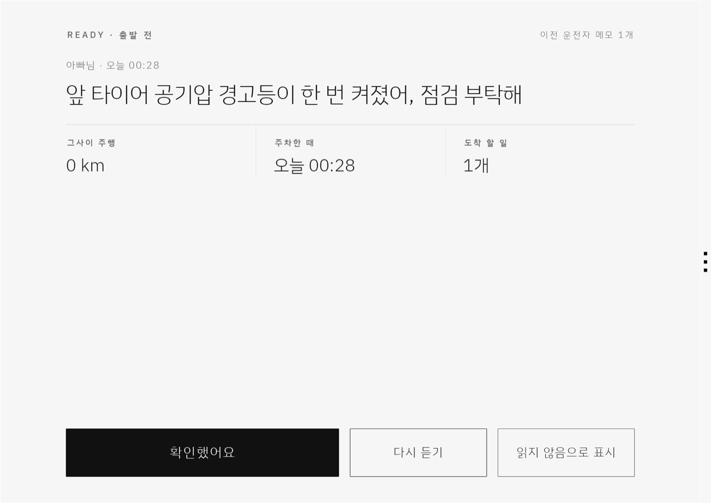
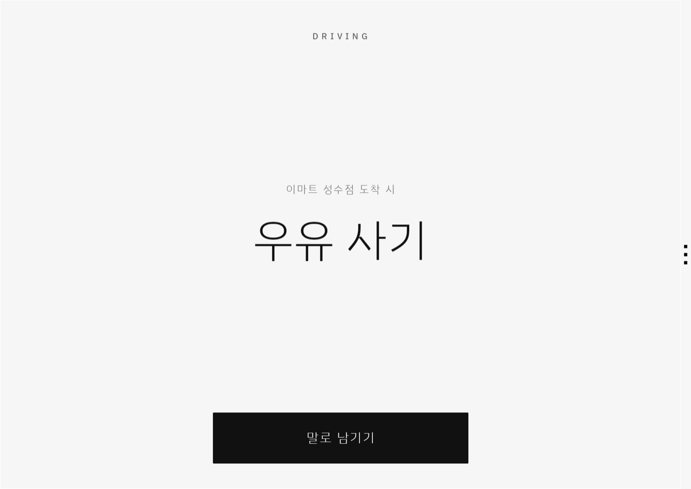
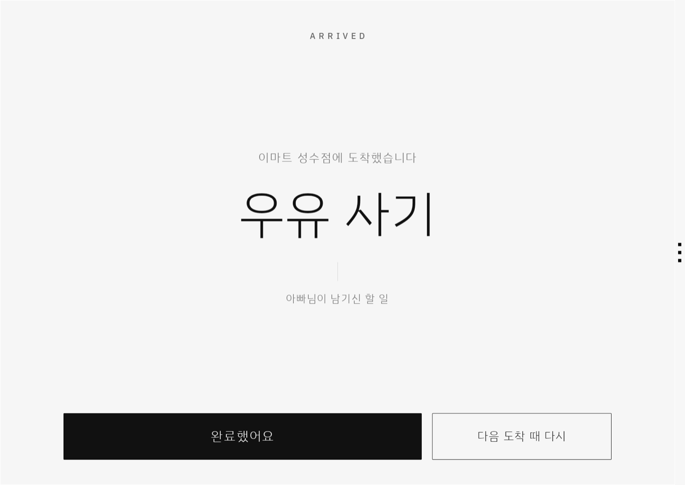

# 차곡 화면 설명

Pleos Connect Emulator v2.1.0(2560×1440)에서 실제 앱을 실행해 찍은 화면입니다. 화면 오른쪽의 앱 영역만 잘라 실었습니다.

시연 시나리오: **아빠가 주차하며 말을 남기고 → 다음 날 엄마가 같은 차로 출발해 메모를 듣고 → 마트에 도착하면 할 일을 안내받는** 흐름입니다.

주행 상태는 기어와 속도로 판단합니다.

| 상태 | 조건 | 화면 |
|---|---|---|
| PARKED · 주차 중 | 기어 P | 전체 화면 (기록·편집 가능) |
| STOPPED · 정차 중 | 기어 D/R, 1 km/h 이하 | 전체 화면 |
| DRIVING · 주행 중 | 5 km/h 이상, 또는 플랫폼이 화면 제한(CarUxRestrictions)을 걸 때 | 큰 글씨 단순 화면 |

---

## 01. 주차 중 홈

**상황**: 차가 P에 있을 때 앱을 열면 보이는 첫 화면입니다.

**동작**
- 왼쪽 **지금 운전자** 드롭다운으로 운전자를 고릅니다. `+ 운전자 추가`로 최대 6명까지 등록할 수 있습니다.
- 다른 운전자로 바꾸면, 그 사람이 아직 듣지 않은 메모를 **"어제 저녁에 아빠님이 남긴 메모입니다…"처럼 언제·누가 남겼는지 먼저 말한 뒤** 읽어 줍니다.
- **남긴 말**: 최근 메모와 작성자·시각·받는 사람이 보입니다. 누르면 상세 화면에서 글레오 AI 도움을 받거나 삭제할 수 있습니다.
- **도착하면 알릴 일**: 장소에 도착했을 때 알려 줄 할 일 목록입니다.
- 아래 버튼으로 **남김말 녹음** 또는 **도착 할 일 추가**를 바로 시작합니다. 왼쪽 메뉴의 **운행일지**에서는 운전자별 주행 기록과 충전·주유비 나누기를 볼 수 있습니다.

---

## 02. 도착 할 일 추가

**상황**: 주차 중에 "다음에 마트 가면 우유 사야지" 같은 할 일을 남길 때입니다.

**동작**
1. 버튼을 누르면 바로 듣기 시작합니다. (오른쪽 위 초록 마이크 = 듣는 중)
2. **"이마트 성수점에 도착하면 우유 사기"**처럼 한 문장으로 말하면, 문장을 나눠 **장소: 이마트 성수점 / 할 일: 우유 사기**로 자동 정리합니다.
3. **받는 사람**을 고릅니다. `나에게` 또는 `다음 운전자에게`.
4. **저장**하면 홈의 '도착하면 알릴 일'에 추가됩니다. 잘못 들었으면 **다시 말하기**.

말을 마치고 2초 동안 조용하면 자동으로 듣기를 끝냅니다.

---

## 03. 주차할 때: 남김말 + 하차 안전 안내

**상황**: 운전을 마치고 기어를 **P**로 바꾸는 순간 자동으로 뜹니다. 운전자가 앱을 따로 열 필요가 없습니다.

**동작**
- 위쪽 **SAFETY 박스**: 주차하는 순간 차량 상태를 읽어, 내리기 전에 확인할 것을 알려 줍니다.
  - 운행 중 **뒷좌석 문이 열렸었다면** → "뒷좌석에 두고 내린 물건이나 아이는 없는지 확인해 주세요."
  - 트렁크·문·창문·충전구가 열려 있으면 → "트렁크가 열려 있어요." 등
- 음성으로 **"다음 운전자께 남길 말씀이 있으신가요?"**라고 묻고, 안내가 끝나면 듣기 시작합니다.
- 말한 내용이 그대로 받아 적힙니다. (예: "타이어 경고등 한 번 켜졌어, 점검 부탁해")
- **받는 사람**: `가족 모두` 또는 특정 운전자.
- **남기기 / 다시 말하기 / 건너뛰기**. 말로 하기 어려우면 **직접 입력**으로 글자를 칠 수도 있습니다.
- 이때 차량 상태(열린 문·창문·트렁크 등)를 **주차 기록**으로 함께 저장합니다. → 04번 화면에서 다음 운전자에게 전달됩니다.

---

## 04. 출발할 때: 메모 전달 + 지난 주차 상태

**상황**: 다음 날 엄마가 같은 차에 타서 기어를 **P → D**로 바꾸는 순간 자동으로 뜹니다. (정차 상태라 아직 전체 화면)

**동작**
- 아직 듣지 않은 메모를 보여 주고, 음성으로 **"이전 운전자께서 남긴 말이 있습니다. 오늘 오전 3시 8분에 아빠님이 남긴 메모입니다. 타이어 경고등 한 번 켜졌어, 점검 부탁해."**처럼 읽어 줍니다.
- **CAR · 차곡이 확인한 지난 주차 상태**: 다른 사람이 주차했을 때 기록된 차량 상태를 알려 줍니다. (예: "트렁크가 열린 채 주차됐어요")
- 아래 칸: **그사이 주행 거리**, **주차한 때**, **도착 할 일 개수**.
- **확인했어요**를 누르거나 다 읽고 나면 '들음'으로 처리되어, 같은 메모를 다시 읽지 않습니다. 놓쳤으면 **다시 듣기**.

---

## 05. 주행 중: 큰 글씨 단순 화면

**상황**: 속도가 5 km/h를 넘거나 플랫폼이 주행 중 화면 제한을 걸면 자동으로 이 화면으로 바뀝니다.

**동작**
- 운전자 주의 분산을 줄이기 위해 **글자를 크게, 정보는 하나만** 보여 줍니다. 목록·입력·작은 버튼은 모두 숨깁니다.
- 다음 할 일이 있으면 **"이마트 성수점 도착 시 · 우유 사기"**를, 없으면 "안전 운전하세요"를 보여 줍니다. 내비 경로가 있으면 남은 거리·시간도 함께 표시합니다.
- 버튼은 **말로 남기기** 하나뿐입니다. 누르면 "말씀하세요"라고 안내하고, 말한 내용을 메모로 저장한 뒤 "남겨 두었어요"라고 답합니다. 화면을 보거나 타이핑할 필요가 없습니다.
- 속도가 1 km/h 이하로 떨어지면 다시 전체 화면으로 돌아갑니다.

---

## 06. 도착 알림

**상황**: 내비 목적지에 도착했을 때, 그 장소에 걸어 둔 할 일이 있으면 뜹니다. (도착 장소 이름과 할 일 장소를 비교해 찾습니다)

**동작**
- 음성으로 **"이마트 성수점에 도착했습니다. 우유 사기, 잊지 마세요."**라고 알려 줍니다.
- 할 일을 크게 보여 주고, **누가 남긴 할 일인지**도 표시합니다. (예: "아빠님이 남기신 할 일")
- **완료했어요** → 목록에서 완료 처리.
- **다음 도착 때 다시** → 남겨 두었다가 다음에 그 장소에 도착하면 다시 알려 줍니다.

> 에뮬레이터 내비는 실제로 목적지까지 이동하지 않으므로, 시연에서는 debug 빌드의 시연용 도착 신호로 이 화면을 띄웁니다. 실행 방법은 저장소 [README](../../README.md)의 '시연 순서'를 참고하세요.
